# bash-server-toolkit

[](https://github.com/Bla-vk/bash-server-toolkit/actions/workflows/shellcheck.yml)

Four small Bash scripts for checking and looking after a Linux server: a health report, an SSH log summary, a rotating backup and a basic hardening check. Every script lints clean with ShellCheck on each push.

I built it to practise Linux administration and shell scripting for a move into cloud engineering. Each script was tested on my own Ubuntu machine, and the hardening check was also run against the sshd config of a real Ubuntu 24.04 EC2 instance.

## Scripts

| Script | What it does | Usage |
|---|---|---|
| `scripts/health-report.sh` | Hostname, kernel, uptime, disk usage with a warning threshold, memory, failed services, top 5 processes by memory | `./scripts/health-report.sh [disk_warn_percent]` |
| `scripts/log-summary.sh` | Counts failed SSH logins and lists the top source IPs and usernames from an auth log | `./scripts/log-summary.sh <logfile> [top_n]` |
| `scripts/backup.sh` | Makes a timestamped `tar.gz` of a directory and keeps only the newest N | `./scripts/backup.sh <source_dir> <backup_dir> [keep]` |
| `scripts/hardening-check.sh` | Checks an SSH config file, listening ports, empty passwords and world-writable files in `/etc` | `./scripts/hardening-check.sh [path/to/sshd_config]` |

Exit codes: `0` success, `1` failed checks, `2` bad input (missing file, unreadable config).

## Requirements

- Linux with Bash 4+, `awk`, `tar`, `ss`, `df`, `free`, `systemctl`
- `sudo` only for the empty-password check in `hardening-check.sh`
- [ShellCheck](https://www.shellcheck.net/) if you want to lint locally

## Setup

```bash
git clone https://github.com/Bla-vk/bash-server-toolkit.git
cd bash-server-toolkit
chmod +x scripts/*.sh
```

## Examples

### Health report

```bash
./scripts/health-report.sh 20
```

The argument is the disk usage percentage at which a filesystem is flagged `WARN`. I set it to 20 here so the warning shows on my laptop.

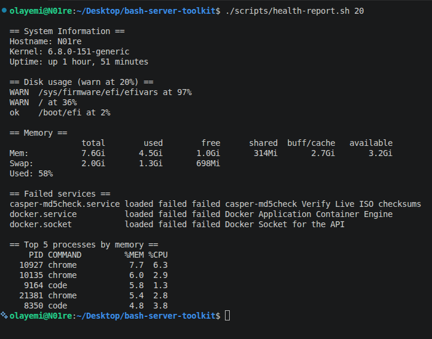

### Log summary

```bash
./scripts/log-summary.sh samples/auth-sample.txt
```

`samples/auth-sample.txt` is made-up data with documentation IP addresses (RFC 5737), so no real logs are in this repo. On a real server, point it at `/var/log/auth.log`.

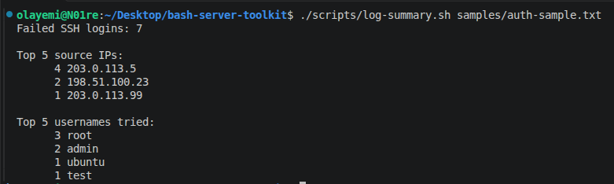

### Backup with rotation

```bash
for i in 1 2 3 4; do ./scripts/backup.sh /tmp/demo/data /tmp/demo/backups 2; sleep 1; done
ls -l /tmp/demo/backups
```

Four backups were made with `keep` set to 2, and only the two newest archives remain.

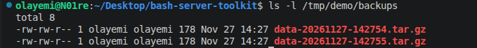

A backup is only useful if it restores. I extracted the newest archive and compared it with the original:

```bash
tar -xzf "$(ls -t /tmp/demo/backups/*.tar.gz | head -n 1)" -C /tmp/demo/restore
diff -r /tmp/demo/data /tmp/demo/restore/data; echo "diff exit: $?"
```

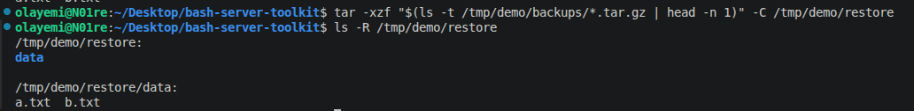

`diff exit: 0` with no other output means the restored files match the originals.

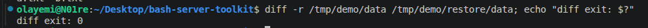

### Hardening check

The SSH check reads a config file that you pass in, so it never touches the live `/etc/ssh/sshd_config` on the machine running it. That also lets it audit a config copied from another server. Without an argument it skips the SSH checks and runs the rest.

Against a deliberately weak config:

```bash
./scripts/hardening-check.sh samples/sshd_config.bad; echo $?
```

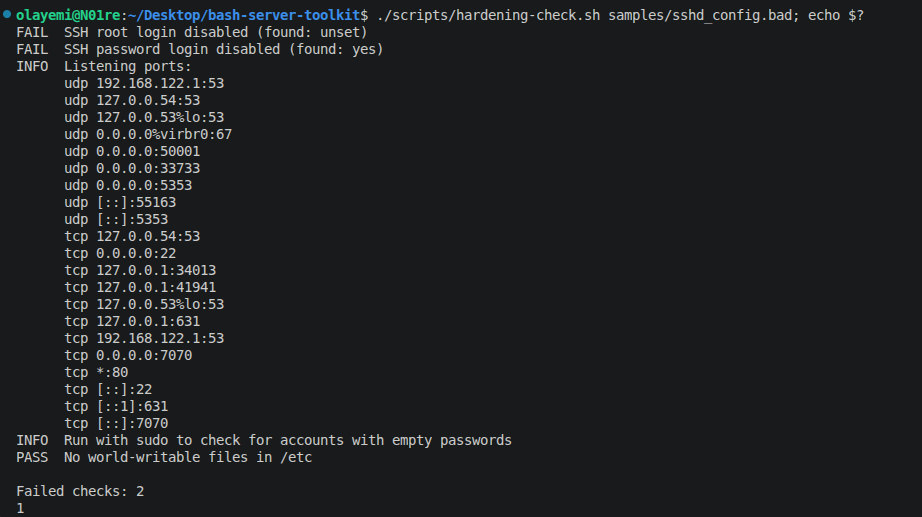

Against a good config:

```bash
./scripts/hardening-check.sh samples/sshd_config.good; echo $?
```

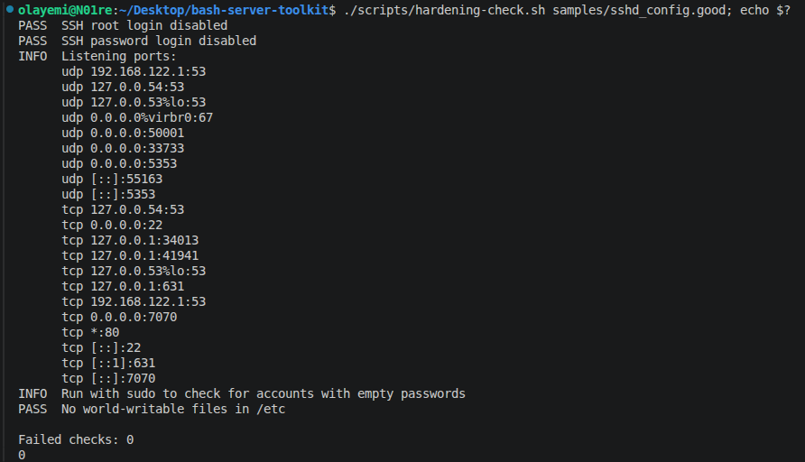

#### Tested on a real server

I copied the sshd config from a throwaway Ubuntu 24.04 EC2 instance and checked it. The first run failed both checks because the settings were not set explicitly:

```bash
scp -i ~/.ssh/<key> ubuntu@<server-ip>:/etc/ssh/sshd_config ~/vm-sshd_config
./scripts/hardening-check.sh ~/vm-sshd_config
```

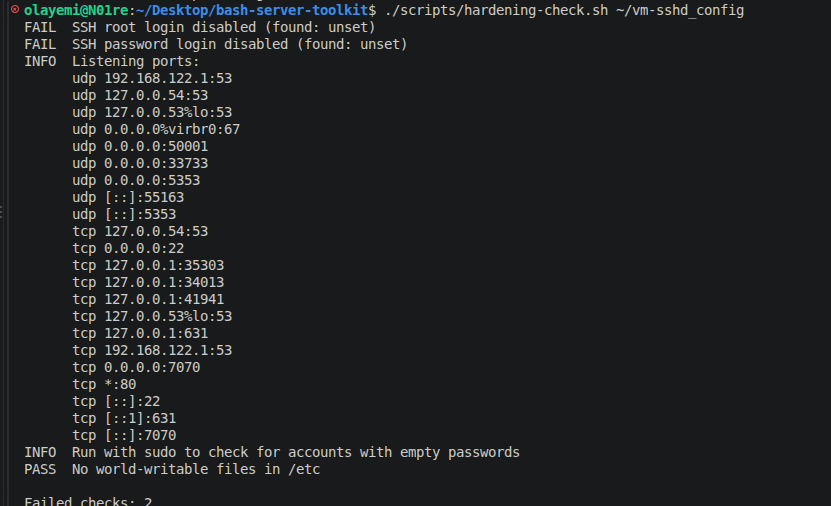

I then added two lines to the server's config, above the `Include` line:

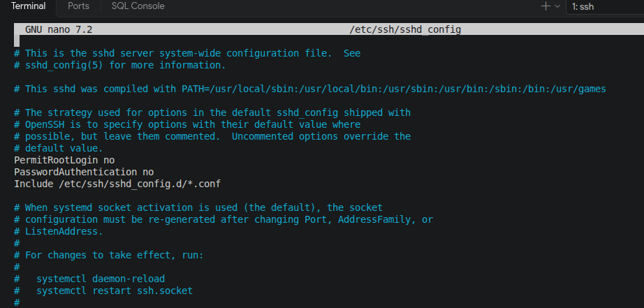

After that, the same check passed:

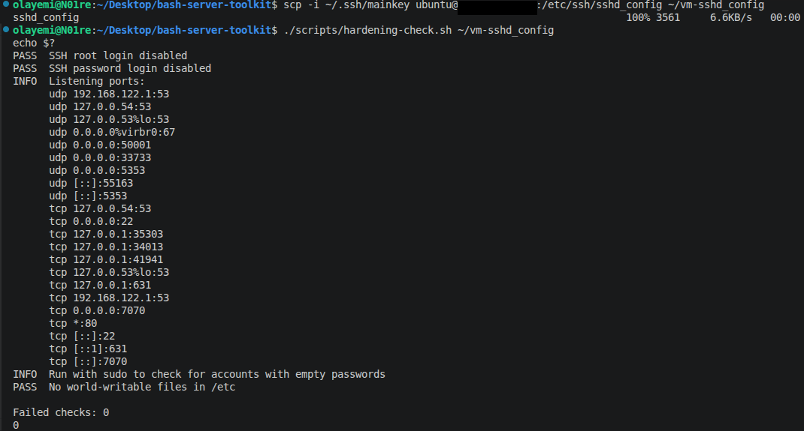

## Problems I hit and what I learned

- **Why the lines go above `Include`.** OpenSSH uses the first value it finds for a setting. On Ubuntu 24.04 the main config includes `/etc/ssh/sshd_config.d/*.conf` near the top, so a setting placed below that line can be overridden. My check also uses first match wins (`awk ... exit`) to copy sshd's behaviour.
- **My first design checked the laptop's own config.** That tested my machine rather than the server I cared about, so I changed the script to take a config file as an argument.
- **Missing config versus bad config.** A setting that is absent is reported as `unset` and fails, because relying on a default is not the same as hardening it.
- **`set -euo pipefail` surfaced bugs early.** An unset `DISK_THRESHOLD` stopped the script instead of silently comparing against nothing, which is how I learned to default arguments with `${1:-80}`.
- **A glob matching two files breaks `tar -tzf`.** The restore test uses the newest archive only.
- **ShellCheck SC2001.** `echo ... | sed 's/^/  /'` was replaced with a `while IFS= read -r` loop.

## Limitations

- Only checks `PermitRootLogin` and `PasswordAuthentication`; it does not parse `Match` blocks or `sshd_config.d` drop-ins.
- Reads `/etc/shadow` for empty passwords, so that check needs `sudo`.
- `health-report.sh` includes pseudo-filesystems such as `efivarfs` in the disk list, which is why `/sys/firmware/efi/efivars` shows `WARN`. Filtering by filesystem type would be the fix.
- `backup.sh` does not encrypt or copy archives off the machine, so it is not a disaster-recovery solution on its own.
- Developed on Ubuntu; other distributions may differ in log paths and service names.

## CI

`.github/workflows/shellcheck.yml` runs ShellCheck on every script for each push and pull request. `main` is protected, so changes go through a pull request with a passing check.

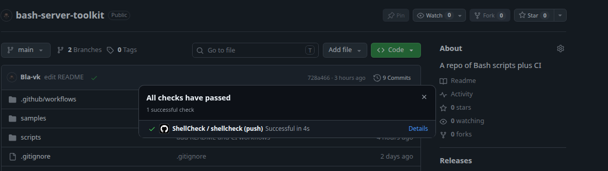

## Repository layout

```
bash-server-toolkit/
├── .github/workflows/shellcheck.yml
├── scripts/
│   ├── health-report.sh
│   ├── log-summary.sh
│   ├── backup.sh
│   └── hardening-check.sh
├── samples/
│   ├── auth-sample.txt
│   ├── sshd_config.good
│   └── sshd_config.bad
├── screenshots/
└── README.md
```

## Possible next steps

- Run `backup.sh` from cron and ship archives to S3
- Add JSON output for use in monitoring
- Check more SSH and kernel settings

## Author

Awoyemi Precious Olayemi — [GitHub](https://github.com/Bla-vk)
